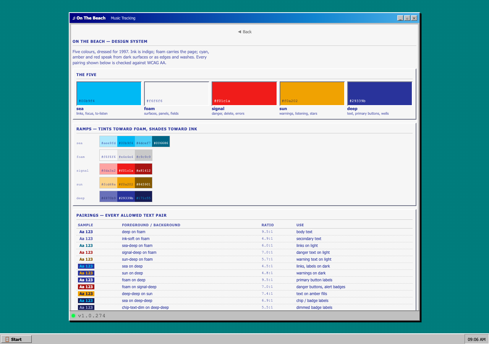
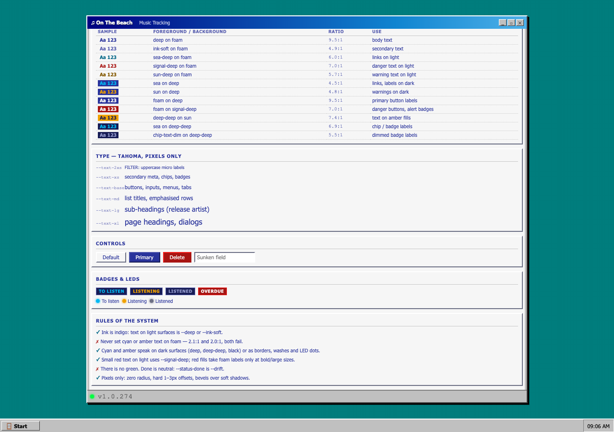
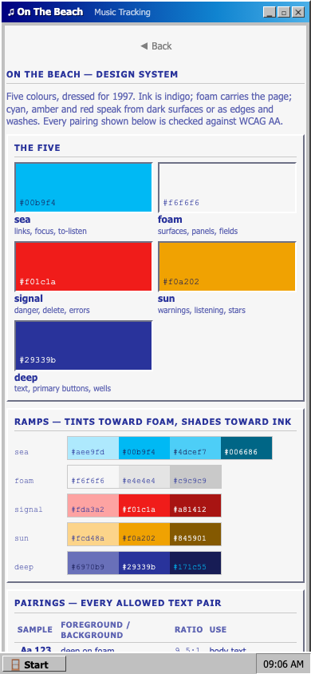
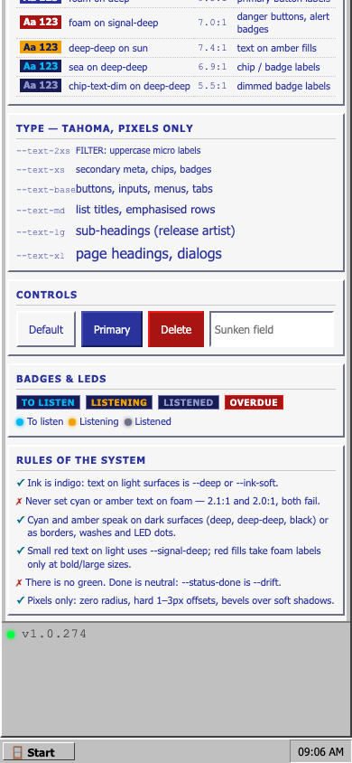

# On The Beach — Design System

Five colours, dressed for 1997. This is the palette the app's retro chrome (Encarta /
Windows 97 / Discworld) is built to use. Tokens live in `src/styles/design-system.css`;
the living reference page is at `/design-system` (Start ▸ 🎨 Design system).

## Screenshots

The reference page at 1280×900 — palette, ramps and the pairing ledger:

Type scale, controls, badges, LEDs and the rules of the system:

The same page at 390×844: swatches drop to two columns, ramps stay intact, and the
pairing ledger wraps:

## The five

| Token      | Hex       | Name              | Speaks as                    |
| ---------- | --------- | ----------------- | ---------------------------- |
| `--sea`    | `#00b9f4` | pool-water cyan   | links, focus, "to listen"    |
| `--foam`   | `#f6f6f6` | sea-foam white    | surfaces, panels, fields     |
| `--signal` | `#f01c1a` | lifeguard red     | danger, delete, errors       |
| `--sun`    | `#f0a202` | afternoon amber   | warnings, "listening", stars |
| `--deep`   | `#29339b` | deep-water indigo | text, primary buttons, wells |

## Ramps

Each colour has hand-picked tints (toward foam) and shades (toward ink) for hover
states, borders and washes — see the `--*-soft` / `--*-mid` / `--*-deep` tokens.
One neutral exists outside the five: `--drift` (`#6e7186`, a desaturated deep) for
disabled text and shadows.

## Roles

- **Ink is indigo.** Body text on light surfaces is `--deep` (9.5:1 on foam);
  secondary text is `--ink-soft` (4.9:1).
- **Links on light** use `--sea-deep` (`#006686`, 6:1) — pure cyan is reserved for
  dark surfaces, where it hits 4.5:1 on `--deep`.
- **Warnings** are `--sun` on dark (4.8:1), `--sun-deep` on light (5.7:1).
- **Danger** is `--signal` for fills, borders and large text; small red text on light
  and red fills (buttons, alert badges) use `--signal-deep` (7:1 with foam labels).
- **Status:** to-listen is sea, listening is sun, listened is `--drift`. There is no
  green in this system by design.

## Allowed text pairings (WCAG AA checked)

| Foreground    | Background  | Ratio | Use                          |
| ------------- | ----------- | ----- | ---------------------------- |
| deep          | foam        | 9.5:1 | body text                    |
| ink-soft      | foam        | 4.9:1 | secondary text               |
| sea-deep      | foam        | 6.0:1 | links on light               |
| signal-deep   | foam        | 7.0:1 | danger text on light         |
| sun-deep      | foam        | 5.7:1 | warning text on light        |
| sea           | deep        | 4.5:1 | links/labels on dark         |
| sun           | deep        | 4.8:1 | warnings on dark             |
| foam          | deep        | 9.5:1 | primary button labels        |
| foam          | signal-deep | 7.0:1 | danger buttons, alert badges |
| deep-deep     | sun         | 7.4:1 | text on amber fills          |
| sea           | deep-deep   | 6.9:1 | chip/badge labels            |
| chip-text-dim | deep-deep   | 5.5:1 | dimmed badge labels          |

Anything not in this table needs a contrast check before it ships.

## Rules of the system

1. Ink is indigo; never set cyan or amber text on foam (2.1:1 / 2.0:1 — both fail).
2. Cyan and amber speak on dark surfaces or as borders, washes and LED dots.
3. Red is danger only. Red fills take foam labels at bold/large sizes; otherwise use
   `--signal-deep` as the fill.
4. No green. "Done" is neutral and dimmed.
5. Pixels only: zero radius, hard 1–3px offset shadows, bevels over soft shadows.
6. Chips/badges use the dark-well recipe: `--chip-bg` well, `--chip-text` label,
   `--chip-border` edge; amber variant via `--chip-text-warn`, dim via
   `--chip-text-dim` (5.5:1 on the well). The alert variant is a `--signal-deep`
   well with a foam label — a `--signal-soft` wash with a `--signal-deep` label
   only reaches 3.9:1, below the 4.5:1 gate for 9px text.

## Relationship to the existing chrome

`design-system.css` is additive: it defines its own token namespace and does not
override the Win98 silver chrome in `main.css` (`--chrome`, `--accent`, `--navy`,
`--danger`, …). When a surface migrates, map old token → new:

| Legacy token    | Design-system token        |
| --------------- | -------------------------- |
| `--accent`      | `--link-on-dark` / `--sea` |
| `--navy`        | `--deep-deep`              |
| `--navy-border` | `--deep-soft`              |
| `--danger`      | `--signal-deep`            |
| `--led-amber`   | `--sun`                    |
| `--star-gold`   | `--sun`                    |
| `--chrome`\*    | `--surface` (foam)         |

\* only where a surface is being moved to the foam world; the silver chrome itself
remains the window frame language.

## Where things live

- Tokens + style-guide page styles: `src/styles/design-system.css`
- Reference page: `src/routes/design-system/+page.svelte`
- Contrast ratios in this doc and on the page were computed with the WCAG 2.x
  relative-luminance formula; re-run the maths if you touch a ramp value.
